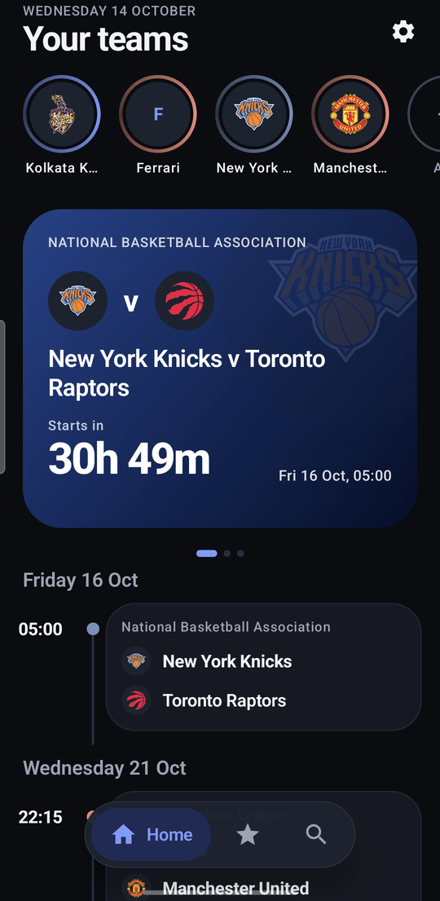
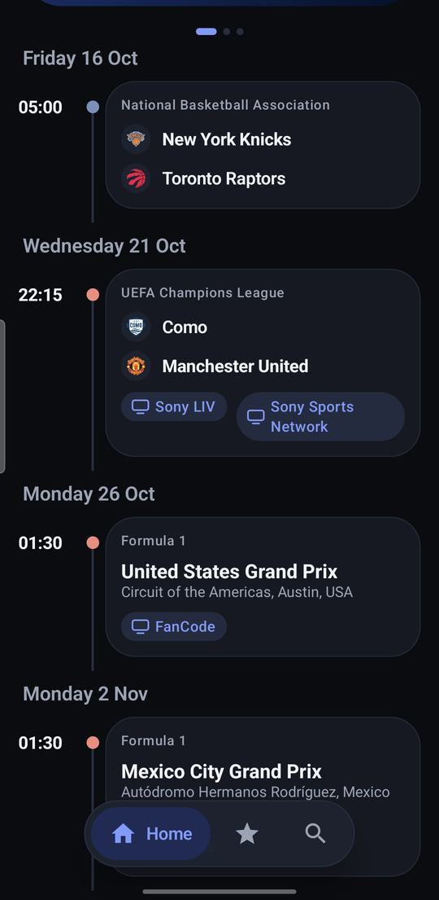
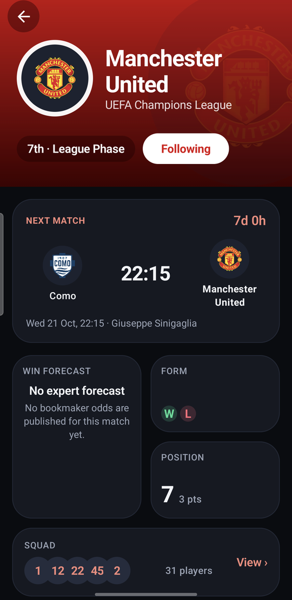
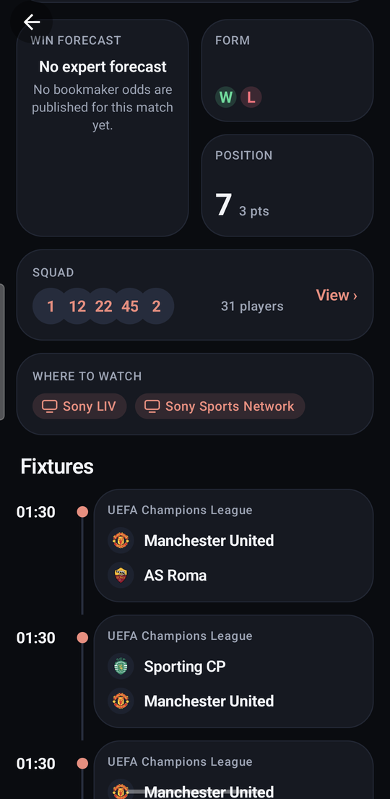
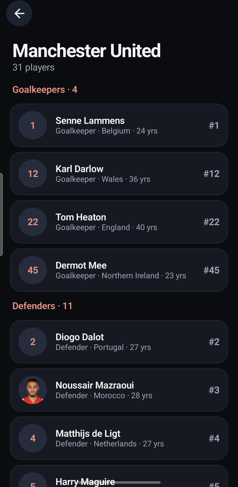
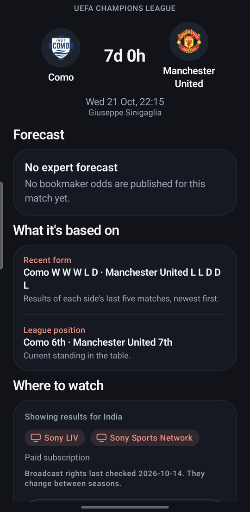
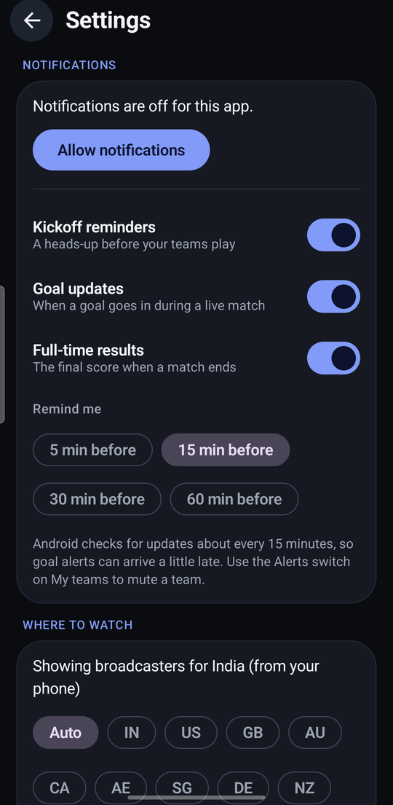
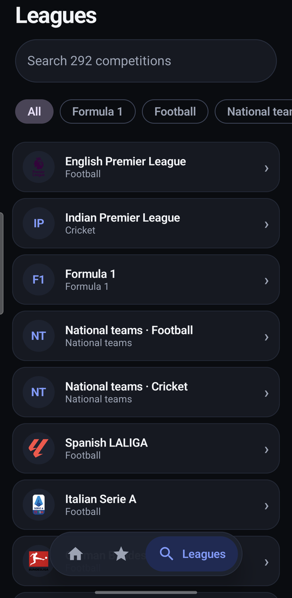

# Sports Hub (formerly F1nalyze)

One Android app to follow all your favourite teams across leagues: fixtures, live scores,
league tables and news for, say, Manchester United, Ferrari and an IPL team in a single feed.

The app is self-contained. It talks to the public sports APIs directly from the phone, and your
followed teams are stored on the device, so there is no server and no account.

```
android/   The app (Kotlin + Jetpack Compose)
ml/        The original F1 race-prediction work (notebook, training script, dataset)
```

## Screenshots

<table>
  <tr>
    <td align="center"><br><sub>Home: story circles, hero card, timeline</sub></td>
    <td align="center"><br><sub>Timeline with where-to-watch chips</sub></td>
    <td align="center"><br><sub>Team page: parallax hero and bento tiles</sub></td>
    <td align="center"><br><sub>Squad, where to watch and fixtures</sub></td>
  </tr>
  <tr>
    <td align="center"><br><sub>Squad grouped by position</sub></td>
    <td align="center"><br><sub>Match sheet: forecast inputs and broadcasters</sub></td>
    <td align="center"><br><sub>Notification and region settings</sub></td>
    <td align="center"><br><sub>About 290 competitions to follow</sub></td>
  </tr>
</table>

## Coverage

About 290 competitions: 219 soccer leagues worldwide, 7 cricket (IPL, Big Bash, ...),
38 US sports leagues, 25 rugby, and Formula 1.

| Data | Source |
|---|---|
| Soccer, cricket tables, news, US sports | ESPN public API (unofficial) |
| Formula 1 | Jolpica-F1 (Ergast successor) |
| IPL fixtures and results | TheSportsDB (free key) |

## Install on a USB-connected phone

1. On the phone, enable Developer options and USB debugging, connect it, and accept the prompt.
2. Install and launch:

   ```bash
   cd android
   ./gradlew installDebug
   ```

   Or open `android/` in Android Studio and press Run.

`android/local.properties` (the SDK path) is machine-specific and git-ignored; Android Studio
creates it for you.

## Tests

```bash
cd android
./gradlew testDebugUnitTest                     # offline unit tests
LIVE_TESTS=1 ./gradlew testDebugUnitTest --tests "*LiveSmokeTest" -i   # hits the real APIs (~12 requests)
```

## How it works

- `data/Http.kt` is the only door to the network. Free APIs rate-limit by IP, so each host gets a
  concurrency cap, a gap between calls, and a 5-minute back-off after a 403/429.
- `data/Cache.kt` caches responses in memory and serves stale data if a refresh fails.
- The list of leagues ships inside the app (`app/src/main/assets/leagues.json`), so there is no
  discovery traffic at startup. To add a league, add it to that file (cricket ids are hand-picked
  because ESPN cannot list them).
- `data/Repository.kt` routes each league to the right source and builds the combined feed.

## Roadmap

Planned work and known limits are in [ROADMAP.md](ROADMAP.md).

## Notes

- ESPN's API is public but unofficial; it can change or block without notice.
- `ml/models/` (3.4 GB of trained models) is git-ignored and not used by the app yet. A
  phone-sized predictor would need a much smaller model.
